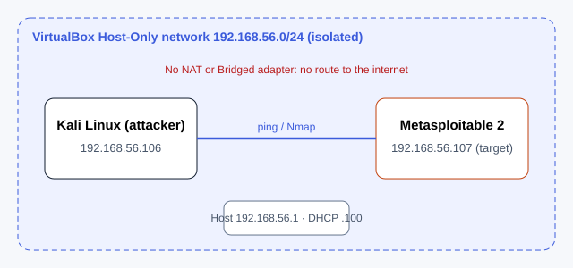

# Project 1: Isolated virtual lab (Kali Linux and Metasploitable 2)

> Tested only on virtual machines I own, inside an isolated Host-Only network.

## Objective
Build a safe, isolated environment for practising scanning and penetration-testing techniques without exposing an intentionally vulnerable machine to a real network.

## Environment and tools
| Item | Detail |
|---|---|
| Hypervisor | Oracle VirtualBox |
| Attacker VM | Kali Linux 2021.2 (Nmap, Wireshark, Metasploit pre-installed) |
| Target VM | Metasploitable 2 (intentionally vulnerable) |
| Network | VirtualBox Host-Only adapter, `192.168.56.0/24` |

## Method
1. **Create the Host-Only network** in VirtualBox Network Manager (IPv4 `192.168.56.1/24`, DHCP enabled). Evidence: `evidence/a1-network-manager.png`.
2. **Set adapters.** Set Adapter 1 of both VMs to *Host-Only Adapter* with the same network name. Bridged mode is avoided so the vulnerable target is never reachable from the physical network. Evidence: `evidence/a2-adapter-settings.png`.
3. **Check IP addresses.** Run `ip a` on each VM. Kali is `192.168.56.106`, Metasploitable is `192.168.56.107`, both on the same subnet. Evidence: `a3-kali-ip.png`, `a4-metasploitable-ip.png`.
4. **Test connectivity.** Ping in both directions (`ping 192.168.56.107` from Kali, `ping 192.168.56.106` from the target). Evidence: `a5-ping-test.png`.
5. **Confirm isolation.** Check that neither VM has an extra NAT or Bridged adapter.

## Results
- Both VMs sit on `192.168.56.0/24` and reach each other with 0% packet loss (7/7 and 6/6 replies, average about 0.3 ms).
- Neither VM has a NAT or Bridged adapter, so the target is isolated from the outside network.

## What I would do differently
- Take a **VM snapshot** of a clean state so the target can be reset after testing.
- Add a **firewall VM (e.g. pfSense)** to practise segmentation and to capture traffic at a choke point.
- Use a **current Kali release** and record exact tool versions in the write-up.
- Keep the Host-Only network list tidy: a second unused adapter (`192.168.166.1/24`) also exists on the host.
